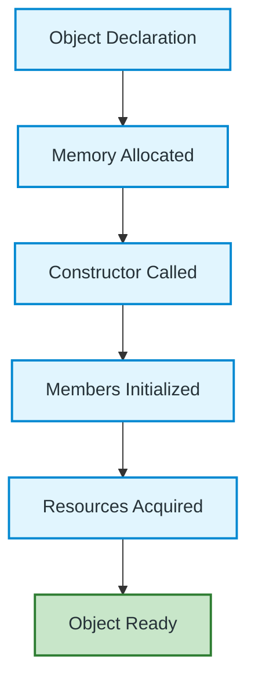
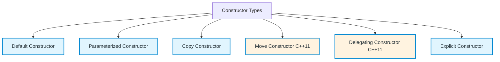
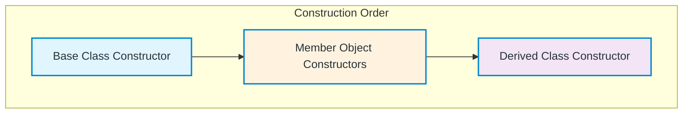
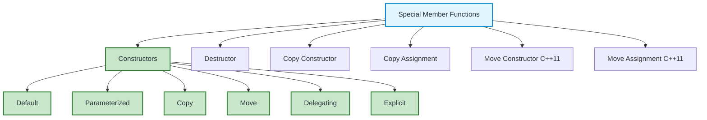

# Constructor in C++ — Complete Guide

A comprehensive guide to understanding constructors, their types, and best practices in C++.

---

## What is a Constructor?

A **constructor** is a special member function of a class that is automatically called when an object is created. It is used to initialize the object's data members and acquire resources.

### Key Characteristics

| Aspect | Behavior |
|--------|----------|
| **Name** | Same as class name (e.g., `Student()`) |
| **Return type** | None (not even `void`) |
| **Invocation** | Automatic on object creation |
| **Overloading** | ✅ Allowed (multiple constructors) |
| **Parameters** | Can accept parameters |
| **Virtual/Static** | Cannot be `virtual` or `static` |
| **Inheritance** | Not inherited (but base constructor called) |

---

## Visual Representation



---

## Constructor Rules

| Rule | Description |
|------|-------------|
| **Name** | Must match class name exactly |
| **Return type** | None (not even `void`) |
| **Automatic call** | Called when object is created |
| **Overloading** | Multiple constructors allowed |
| **Parameters** | Can accept any number of parameters |
| **Virtual** | ❌ Cannot be virtual |
| **Static** | ❌ Cannot be static |
| **Inheritance** | Not inherited; base called first |
| **Default** | Compiler provides if none defined |

---

## Types of Constructors



---

## 1. Default Constructor

Called when object is created without arguments.

```cpp
#include <iostream>
using namespace std;

class Student {
public:
    string name;
    int age;
    
    // Default constructor
    Student() : name("Unknown"), age(0) {
        cout << "Default constructor called" << endl;
    }
    
    void display() {
        cout << name << " - " << age << endl;
    }
};

int main() {
    Student s1;      // Default constructor called
    Student s2 = Student();  // Also default constructor
    s1.display();    // Unknown - 0
    s2.display();    // Unknown - 0
    return 0;
}
```

**Output:**
```
Default constructor called
Default constructor called
Unknown - 0
Unknown - 0
```

### When Compiler Provides Default Constructor
- No user-defined constructors exist
- All members have default constructors
- No virtual functions or virtual base classes

---

## 2. Parameterized Constructor

Accepts arguments to initialize object with specific values.

```cpp
#include <iostream>
using namespace std;

class Student {
public:
    string name;
    int age;
    float gpa;
    
    // Parameterized constructor
    Student(string n, int a, float g = 0.0f) : name(n), age(a), gpa(g) {
        cout << "Parameterized constructor called for " << name << endl;
    }
    
    void display() {
        cout << name << " - Age: " << age << " - GPA: " << gpa << endl;
    }
};

int main() {
    Student s1("Alice", 20, 3.8f);
    Student s2("Bob", 22);        // Uses default gpa = 0.0
    Student s3 = Student("Carol", 19, 3.9f);
    
    s1.display();  // Alice - Age: 20 - GPA: 3.8
    s2.display();  // Bob - Age: 22 - GPA: 0
    s3.display();  // Carol - Age: 19 - GPA: 3.9
    
    return 0;
}
```

---

## 3. Copy Constructor

Creates a new object as a copy of an existing object.

```cpp
#include <iostream>
using namespace std;

class Student {
public:
    string name;
    int* marks;  // Dynamic memory
    
    Student(string n, int m) : name(n) {
        marks = new int(m);
    }
    
    // Copy constructor (Deep copy)
    Student(const Student& other) : name(other.name) {
        marks = new int(*other.marks);  // Allocate NEW memory
        cout << "Copy constructor called for " << name << endl;
    }
    
    ~Student() { delete marks; }
    
    void display() {
        cout << name << ": " << *marks << endl;
    }
};

int main() {
    Student s1("Alice", 90);
    Student s2 = s1;        // Copy constructor called
    Student s3(s1);         // Copy constructor called
    
    s1.display();  // Alice: 90
    s2.display();  // Alice: 90
    s3.display();  // Alice: 90
    
    *s2.marks = 50;  // Only affects s2 (deep copy)
    
    s1.display();  // Alice: 90 (unchanged!)
    s2.display();  // Alice: 50
    s3.display();  // Alice: 90 (unchanged!)
    
    return 0;
}
```

### Copy Constructor Syntax
```cpp
// Standard form
ClassName(const ClassName& other);

// With additional parameters (rare)
ClassName(const ClassName& other, int extra);
```

### When Copy Constructor is Called
| Scenario | Example |
|----------|---------|
| Initialization | `Student s2 = s1;` |
| Pass by value | `void func(Student s);` |
| Return by value | `Student func() { return s; }` |
| Explicit call | `Student s2(s1);` |

---

## 4. Move Constructor (C++11)

Transfers resources from temporary object (rvalue).

```cpp
#include <iostream>
#include <utility>
using namespace std;

class Student {
public:
    string name;
    int* marks;
    
    Student(string n, int m) : name(n), marks(new int(m)) {}
    
    // Move constructor
    Student(Student&& other) noexcept : name(std::move(other.name)), marks(other.marks) {
        other.marks = nullptr;  // Important: nullify source
        cout << "Move constructor called for " << name << endl;
    }
    
    ~Student() { delete marks; }
    
    void display() {
        if (marks) cout << name << ": " << *marks << endl;
        else cout << name << ": (moved from)" << endl;
    }
};

int main() {
    Student s1("Alice", 90);
    Student s2 = std::move(s1);  // Move constructor
    
    s1.display();  // Alice: (moved from)
    s2.display();  // Alice: 90
    
    return 0;
}
```

---

## 5. Delegating Constructor (C++11)

One constructor calls another constructor of the same class.

```cpp
#include <iostream>
using namespace std;

class Student {
public:
    string name;
    int age;
    float gpa;
    
    // Target constructor
    Student(string n, int a, float g) : name(n), age(a), gpa(g) {
        cout << "Target constructor called" << endl;
    }
    
    // Delegating constructors
    Student() : Student("Unknown", 0, 0.0f) {
        cout << "Delegating: default" << endl;
    }
    
    Student(string n) : Student(n, 0, 0.0f) {
        cout << "Delegating: name only" << endl;
    }
    
    Student(string n, int a) : Student(n, a, 0.0f) {
        cout << "Delegating: name + age" << endl;
    }
};

int main() {
    Student s1;              // Calls default → target
    Student s2("Bob");       // Calls name only → target
    Student s3("Carol", 20); // Calls name+age → target
    Student s4("Dave", 22, 3.5f); // Calls target directly
    return 0;
}
```

---

## 6. Explicit Constructor

Prevents implicit conversions.

```cpp
#include <iostream>
using namespace std;

class Student {
public:
    int age;
    
    // Without explicit - allows implicit conversion
    Student(int a) : age(a) {}
    
    // With explicit - prevents implicit conversion
    explicit Student(double a) : age(static_cast<int>(a)) {}
};

void printAge(Student s) {
    cout << "Age: " << s.age << endl;
}

int main() {
    Student s1 = 20;        // OK: implicit conversion int → Student
    // Student s2 = 20.5;   // ERROR: explicit prevents double → Student
    Student s3(20.5);       // OK: explicit construction
    Student s4 = Student(20.5); // OK: explicit construction
    
    printAge(20);           // OK: implicit conversion
    // printAge(20.5);      // ERROR: explicit prevents conversion
    
    return 0;
}
```

---

## Constructor Call Order in Inheritance



### Code Example

```cpp
#include <iostream>
using namespace std;

class Base {
public:
    Base() { cout << "1. Base constructor" << endl; }
    Base(int x) { cout << "1. Base constructor with int" << endl; }
};

class Member {
public:
    Member() { cout << "2. Member constructor" << endl; }
};

class Derived : public Base {
    Member m;
public:
    Derived() { cout << "3. Derived constructor" << endl; }
    Derived(int x) : Base(x) { cout << "3. Derived constructor with int" << endl; }
};

int main() {
    Derived d1;      // Base → Member → Derived
    cout << "---" << endl;
    Derived d2(10);  // Base(int) → Member → Derived(int)
    return 0;
}
```

**Output:**
```
1. Base constructor
2. Member constructor
3. Derived constructor
---
1. Base constructor with int
2. Member constructor
3. Derived constructor with int
```

---

## Constructor Initializer List

**Preferred way** to initialize members.

```cpp
class Student {
    string name;
    int age;
    const int id;        // Must use initializer list
    int& ref;            // Must use initializer list
    
public:
    // ✅ GOOD: Initializer list
    Student(string n, int a, int i, int& r) 
        : name(n), age(a), id(i), ref(r) {}
    
    // ❌ BAD: Assignment in body (less efficient)
    Student(string n, int a) {
        name = n;  // Default constructs then assigns
        age = a;
    }
};
```

### Benefits of Initializer List
| Benefit | Description |
|---------|-------------|
| **Performance** | Direct initialization, no default + assign |
| **Required for** | `const` members, references, no default constructor |
| **Base classes** | Must initialize base class constructors |
| **Members** | Initializes in declaration order (not list order) |

---

## Special Member Functions Summary



---

## Modern C++ Best Practices

| Practice | Description |
|----------|-------------|
| **Use initializer lists** | Always prefer over assignment in body |
| **Prefer `= default`** | For trivial constructors |
| **Use `explicit`** | For single-argument constructors |
| **Implement Rule of Five** | If managing resources manually |
| **Use delegating constructors** | Reduce code duplication |
| **Prefer smart pointers** | Avoid manual memory in constructors |
| **Mark `noexcept`** | For move constructors when possible |

---

## Common Mistakes

| Mistake | Problem | Solution |
|---------|---------|----------|
| No default constructor | Can't create arrays/vectors | Provide default or use `= default` |
| Shallow copy in copy constructor | Double free | Implement deep copy |
| Forgetting base constructor | Base not initialized | Call base in initializer list |
| Assignment vs initialization | Inefficient | Use initializer list |
| Non-explicit single-arg | Unwanted conversions | Add `explicit` keyword |

---

## Quick Reference

```cpp
// Default constructor
ClassName() = default;
ClassName() : member(value) {}

// Parameterized constructor
ClassName(Type param) : member(param) {}

// Copy constructor
ClassName(const ClassName& other) : member(other.member) {}

// Move constructor (C++11)
ClassName(ClassName&& other) noexcept : member(std::move(other.member)) {}

// Delegating constructor (C++11)
ClassName() : ClassName(default_value) {}

// Explicit constructor
explicit ClassName(Type param) : member(param) {}

// Constructor with default arguments
ClassName(Type param = default_value) : member(param) {}
```

---

## Summary

- **Constructor** = special function for object initialization
- **Types**: Default, Parameterized, Copy, Move, Delegating, Explicit
- **Initializer list** = preferred way to initialize members
- **Inheritance order**: Base → Members → Derived
- **Rule of Five**: If custom constructor needed, consider all 5 special functions
- **Modern C++**: Use `= default`, `explicit`, delegating, and smart pointers
- **Cannot be**: virtual, static, or return a value