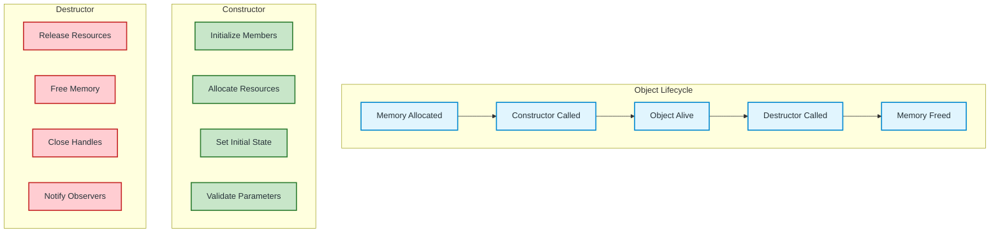
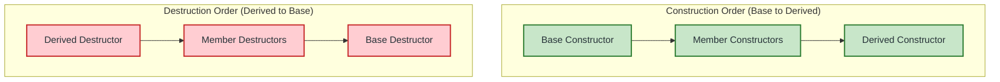

# Constructor vs Destructor in C++ — Complete Comparison

A comprehensive side-by-side comparison of constructors and destructors with examples, use cases, and best practices.

---

## Quick Comparison Overview

| Aspect | Constructor | Destructor |
|--------|-------------|------------|
| **Purpose** | Initialize object | Clean up object |
| **Name** | Class name (e.g., `Student()`) | `~` + Class name (e.g., `~Student()`) |
| **Return type** | None (not even `void`) | None (not even `void`) |
| **Parameters** | Can have parameters | Cannot have parameters |
| **Overloading** | ✅ Allowed (multiple constructors) | ❌ Not allowed (only one) |
| **Invocation** | Explicit (creation) or implicit | Automatic (destruction) |
| **Order (inheritance)** | Base → Derived | Derived → Base |
| **Virtual** | Cannot be virtual | Should be virtual in base classes |
| **Default provided** | Yes (if none defined) | Yes (if none defined) |

---

## Visual Comparison



---

## Syntax Comparison

### Constructor
```cpp
class Student {
public:
    // Default constructor
    Student() : name("Unknown"), age(0) {}
    
    // Parameterized constructor
    Student(string n, int a) : name(n), age(a) {}
    
    // Copy constructor
    Student(const Student& other) : name(other.name), age(other.age) {}
    
    // Move constructor (C++11)
    Student(Student&& other) noexcept : name(std::move(other.name)), age(other.age) {}
    
private:
    string name;
    int age;
};
```

### Destructor
```cpp
class Student {
public:
    // Only ONE destructor allowed
    ~Student() {
        // Cleanup code
        cout << "Student destroyed" << endl;
    }
    
    // Virtual destructor for polymorphism
    virtual ~Student() {
        // Cleanup code
    }
    
    // Default destructor (C++11)
    ~Student() = default;
    
    // Deleted destructor (prevent destruction)
    ~Student() = delete;
    
private:
    string name;
    int age;
};
```

---

## Call Order in Inheritance



### Code Example

```cpp
#include <iostream>
using namespace std;

class Base {
public:
    Base() { cout << "1. Base Constructor" << endl; }
    virtual ~Base() { cout << "4. Base Destructor" << endl; }
};

class Member {
public:
    Member() { cout << "2. Member Constructor" << endl; }
    ~Member() { cout << "3. Member Destructor" << endl; }
};

class Derived : public Base {
    Member m;
public:
    Derived() { cout << "3. Derived Constructor" << endl; }
    ~Derived() { cout << "2. Derived Destructor" << endl; }
};

int main() {
    Derived d;
    cout << "--- Object alive ---" << endl;
    return 0;
}
```

**Output:**
```
1. Base Constructor
2. Member Constructor
3. Derived Constructor
--- Object alive ---
2. Derived Destructor
3. Member Destructor
4. Base Destructor
```

---

## Parameter Differences

### Constructor - Flexible Parameters
```cpp
class Student {
public:
    // No parameters
    Student() : name("Default"), age(0) {}
    
    // One parameter
    Student(string n) : name(n), age(0) {}
    
    // Multiple parameters
    Student(string n, int a, float g) : name(n), age(a), gpa(g) {}
    
    // With default arguments
    Student(string n = "Unknown", int a = 0) : name(n), age(a) {}
    
    // Initializer list (preferred)
    Student(string n, int a) : name(n), age(a) {}
    
private:
    string name;
    int age;
    float gpa;
};
```

### Destructor - No Parameters Ever
```cpp
class Student {
public:
    // ❌ INVALID - Destructor cannot have parameters
    // ~Student(int code) { }
    
    // ✅ VALID - No parameters
    ~Student() {
        // Cleanup
    }
    
    // ✅ VALID - Virtual for polymorphism
    virtual ~Student() {
        // Cleanup
    }
};
```

---