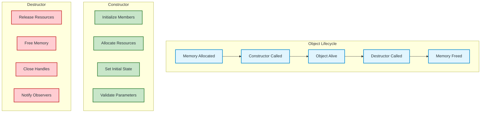
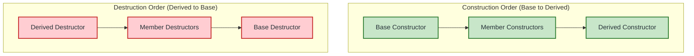
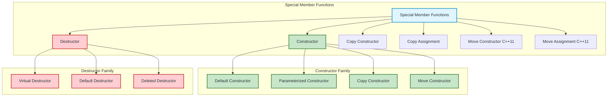

# Constructor vs Destructor in C++ — Complete Comparison

A comprehensive side-by-side comparison of constructors and destructors with examples, use cases, and best practices.

---

## Quick Comparison Overview

| Aspect | Constructor | Destructor |
|--------|-------------|------------|
| **Purpose** | Initialize object | Clean up object |
| **Name** | Class name (e.g., `Student()`) | `~` + Class name (e.g., `~Student()`) |
| **Return type** | None (not even `void`) | None (not even `void`) |
| **Parameters** | Can have parameters | Cannot have parameters |
| **Overloading** | ✅ Allowed (multiple constructors) | ❌ Not allowed (only one) |
| **Invocation** | Explicit (creation) or implicit | Automatic (destruction) |
| **Order (inheritance)** | Base → Derived | Derived → Base |
| **Virtual** | Cannot be virtual | Should be virtual in base classes |
| **Default provided** | Yes (if none defined) | Yes (if none defined) |

---

## Visual Comparison



---

## Syntax Comparison

### Constructor
```cpp
class Student {
public:
    // Default constructor
    Student() : name("Unknown"), age(0) {}
    
    // Parameterized constructor
    Student(string n, int a) : name(n), age(a) {}
    
    // Copy constructor
    Student(const Student& other) : name(other.name), age(other.age) {}
    
    // Move constructor (C++11)
    Student(Student&& other) noexcept : name(std::move(other.name)), age(other.age) {}
    
private:
    string name;
    int age;
};
```

### Destructor
```cpp
class Student {
public:
    // Only ONE destructor allowed
    ~Student() {
        // Cleanup code
        cout << "Student destroyed" << endl;
    }
    
    // Virtual destructor for polymorphism
    virtual ~Student() {
        // Cleanup code
    }
    
    // Default destructor (C++11)
    ~Student() = default;
    
    // Deleted destructor (prevent destruction)
    ~Student() = delete;
    
private:
    string name;
    int age;
};
```

---

## Call Order in Inheritance



### Code Example

```cpp
#include <iostream>
using namespace std;

class Base {
public:
    Base() { cout << "1. Base Constructor" << endl; }
    virtual ~Base() { cout << "4. Base Destructor" << endl; }
};

class Member {
public:
    Member() { cout << "2. Member Constructor" << endl; }
    ~Member() { cout << "3. Member Destructor" << endl; }
};

class Derived : public Base {
    Member m;
public:
    Derived() { cout << "3. Derived Constructor" << endl; }
    ~Derived() { cout << "2. Derived Destructor" << endl; }
};

int main() {
    Derived d;
    cout << "--- Object alive ---" << endl;
    return 0;
}
```

**Output:**
```
1. Base Constructor
2. Member Constructor
3. Derived Constructor
--- Object alive ---
2. Derived Destructor
3. Member Destructor
4. Base Destructor
```

---

## Parameter Differences

### Constructor - Flexible Parameters
```cpp
class Student {
public:
    // No parameters
    Student() : name("Default"), age(0) {}
    
    // One parameter
    Student(string n) : name(n), age(0) {}
    
    // Multiple parameters
    Student(string n, int a, float g) : name(n), age(a), gpa(g) {}
    
    // With default arguments
    Student(string n = "Unknown", int a = 0) : name(n), age(a) {}
    
    // Initializer list (preferred)
    Student(string n, int a) : name(n), age(a) {}
    
private:
    string name;
    int age;
    float gpa;
};
```

### Destructor - No Parameters Ever
```cpp
class Student {
public:
    // ❌ INVALID - Destructor cannot have parameters
    // ~Student(int code) { }
    
    // ✅ VALID - No parameters
    ~Student() {
        // Cleanup
    }
    
    // ✅ VALID - Virtual for polymorphism
    virtual ~Student() {
        // Cleanup
    }
};
```

---

## Overloading Comparison

### Constructor - Multiple Overloads Allowed
```cpp
class Point {
public:
    Point() : x(0), y(0) {}                    // Default
    Point(int x) : x(x), y(0) {}               // Single param
    Point(int x, int y) : x(x), y(y) {}        // Two params
    Point(const Point& other) : x(other.x), y(other.y) {}  // Copy
    Point(Point&& other) noexcept : x(other.x), y(other.y) {}  // Move
    
private:
    int x, y;
};
```

### Destructor - Only ONE Allowed
```cpp
class Point {
public:
    // ✅ Only one destructor
    ~Point() { cout << "Point destroyed" << endl; }
    
    // ❌ INVALID - Cannot overload
    // ~Point(int code) { }
    // ~Point(string reason) { }
};
```

---

## Virtual Behavior

### Constructor - Cannot Be Virtual
```cpp
class Base {
public:
    // ❌ INVALID - Constructor cannot be virtual
    // virtual Base() { }
    
    Base() { cout << "Base constructor" << endl; }
};

class Derived : public Base {
public:
    Derived() { cout << "Derived constructor" << endl; }
};
```

### Destructor - Should Be Virtual in Base Classes
```cpp
class Base {
public:
    Base() { cout << "Base constructor" << endl; }
    
    // ✅ Virtual destructor - enables polymorphic deletion
    virtual ~Base() { cout << "Base destructor" << endl; }
};

class Derived : public Base {
public:
    Derived() { cout << "Derived constructor" << endl; }
    ~Derived() { cout << "Derived destructor" << endl; }
};

int main() {
    Base* ptr = new Derived();
    delete ptr;  // Calls Derived destructor, then Base destructor
    return 0;
}
```

---

## Resource Management Patterns

### Constructor: Acquire Resources (RAII)
```cpp
class FileHandler {
    std::fstream file;
    
public:
    // Constructor acquires resource
    FileHandler(const string& filename) : file(filename) {
        if (!file.is_open()) {
            throw runtime_error("Cannot open file");
        }
    }
    
    // Destructor releases resource automatically
    ~FileHandler() {
        if (file.is_open()) {
            file.close();
        }
    }
};
```

### Modern C++: Let Smart Pointers Handle It
```cpp
#include <memory>

class ResourceManager {
    // No manual constructor/destructor needed for memory!
    std::unique_ptr<int[]> data;
    size_t size;
    
public:
    ResourceManager(size_t s) : size(s), data(std::make_unique<int[]>(s)) {}
    
    // Default destructor works perfectly!
    // ~ResourceManager() = default;
};
```

---

## Special Member Functions Summary



---

## When to Use Each

### Define Custom Constructor When:
- ✅ Need to initialize members with specific values
- ✅ Need to acquire resources (memory, files, connections)
- ✅ Need to validate input parameters
- ✅ Need multiple ways to create object (overloading)
- ✅ Need to prevent implicit conversions (`explicit`)

### Define Custom Destructor When:
- ✅ Class owns raw pointers (manual memory management)
- ✅ Class manages resources (file handles, sockets, locks)
- ✅ Need to perform cleanup actions (logging, notifications)
- ✅ Base class for polymorphism (make it `virtual`)
- ✅ Need to release non-memory resources

### Use Default (Compiler-Generated) When:
- ✅ All members are trivially destructible (int, string, vector, etc.)
- ✅ Using smart pointers (`unique_ptr`, `shared_ptr`)
- ✅ Using standard containers (`vector`, `map`, etc.)
- ✅ No special cleanup needed

---

## Complete Example: Rule of Five

```cpp
#include <iostream>
#include <algorithm>
#include <memory>
using namespace std;

class Buffer {
private:
    int* data;
    size_t size;
    
public:
    // 1. Constructor
    Buffer(size_t s = 0) : size(s), data(s ? new int[s] : nullptr) {
        cout << "Constructor: allocated " << size << " ints" << endl;
    }
    
    // 2. Destructor
    ~Buffer() {
        delete[] data;
        cout << "Destructor: freed " << size << " ints" << endl;
    }
    
    // 3. Copy Constructor
    Buffer(const Buffer& other) : size(other.size), data(new int[other.size]) {
        copy(other.data, other.data + size, data);
        cout << "Copy Constructor" << endl;
    }
    
    // 4. Copy Assignment
    Buffer& operator=(const Buffer& other) {
        if (this != &other) {
            delete[] data;
            size = other.size;
            data = new int[size];
            copy(other.data, other.data + size, data);
        }
        cout << "Copy Assignment" << endl;
        return *this;
    }
    
    // 5. Move Constructor (C++11)
    Buffer(Buffer&& other) noexcept : data(other.data), size(other.size) {
        other.data = nullptr;
        other.size = 0;
        cout << "Move Constructor" << endl;
    }
    
    // 6. Move Assignment (C++11)
    Buffer& operator=(Buffer&& other) noexcept {
        if (this != &other) {
            delete[] data;
            data = other.data;
            size = other.size;
            other.data = nullptr;
            other.size = 0;
        }
        cout << "Move Assignment" << endl;
        return *this;
    }
};

int main() {
    Buffer b1(10);           // Constructor
    Buffer b2 = b1;          // Copy Constructor
    Buffer b3(5);            // Constructor
    b3 = b1;                 // Copy Assignment
    Buffer b4 = std::move(b1); // Move Constructor
    b3 = std::move(b2);      // Move Assignment
    return 0;                // Destructors called
}
```

---

## Modern C++ Best Practices

| Scenario | Recommendation |
|----------|----------------|
| **Simple class** | Use default constructor/destructor |
| **Raw pointers** | Implement Rule of Five OR use smart pointers |
| **Polymorphic base** | **Always** virtual destructor |
| **Resource acquisition** | Constructor acquires, destructor releases (RAII) |
| **C++11+** | Prefer `unique_ptr`/`shared_ptr` over raw pointers |
| **Performance** | Implement move operations for expensive-to-copy types |
| **Non-copyable** | Delete copy constructor/assignment: `= delete` |

---

## Common Mistakes

| Mistake | Problem | Solution |
|---------|---------|----------|
| Non-virtual base destructor | Memory leak with polymorphism | Add `virtual ~Base()` |
| Throwing in destructor | Undefined behavior | Never throw in destructor |
| Manual `delete` with smart pointers | Double free | Let smart pointer manage |
| Forgetting Rule of Three/Five | Shallow copy bugs | Implement all or use smart pointers |
| Calling destructor explicitly | Double destruction | Only with placement new |

---

## Summary

| Feature | Constructor | Destructor |
|---------|-------------|------------|
| **Multiple allowed** | ✅ Yes | ❌ No |
| **Parameters allowed** | ✅ Yes | ❌ No |
| **Can be virtual** | ❌ No | ✅ Yes (recommended for base) |
| **Called automatically** | On creation | On destruction |
| **Inheritance order** | Base → Derived | Derived → Base |
| **Primary role** | Initialize | Cleanup |
| **Modern C++** | Often not needed (RAII) | Often not needed (RAII) |

> **Key Insight**: In modern C++, both constructors and destructors are often unnecessary when using RAII with smart pointers and standard containers. The compiler-generated versions work perfectly for most cases.