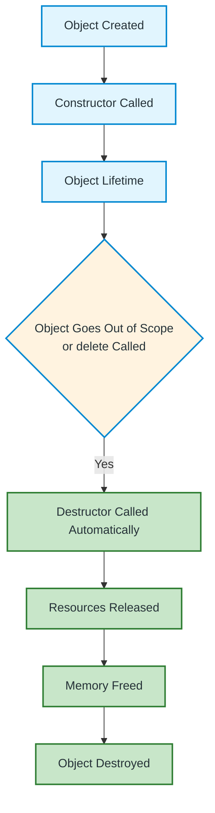
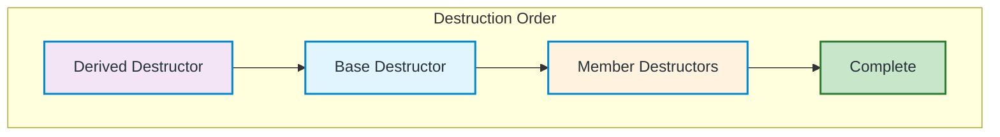

# Destructor in C++ — Complete Guide

A comprehensive guide to understanding destructors, their implementation, and best practices in C++.

---

## What is a Destructor?

A **destructor** is a special member function of a class that is automatically called when an object is destroyed. It is mainly used to release resources such as dynamically allocated memory, files, sockets, and other resources owned by an object.

### Key Characteristics

| Aspect | Behavior |
|--------|----------|
| **Name** | Class name preceded by `~` (e.g., `~Student()`) |
| **Return type** | None (not even `void`) |
| **Parameters** | Takes no parameters |
| **Overloading** | Cannot be overloaded (only one per class) |
| **Invocation** | Automatic when object goes out of scope or is deleted |
| **Inheritance** | Base class destructor called after derived class destructor |

---

## Visual Representation



---

## Syntax and Rules

```cpp
class Student {
public:
    // Constructor
    Student() {
        // Initialize resources
    }
    
    // Destructor
    ~Student() {
        // Clean up resources
    }
};
```

### Rules Summary

| Rule | Description |
|------|-------------|
| **Name** | `~ClassName()` |
| **Return type** | None (not even `void`) |
| **Parameters** | None (cannot accept arguments) |
| **Overloading** | Not allowed (only one destructor per class) |
| **Access specifier** | Usually `public` (can be `private` for special patterns) |
| **Virtual** | Should be `virtual` in base classes for polymorphism |

---

## Code Examples

### Basic Destructor

```cpp
#include <iostream>
using namespace std;

class Student {
public:
    string name;
    
    Student(string n) : name(n) {
        cout << "Constructor: " << name << " created" << endl;
    }
    
    ~Student() {
        cout << "Destructor: " << name << " destroyed" << endl;
    }
};

int main() {
    Student s1("Alice");  // Constructor called
    Student s2("Bob");    // Constructor called
    
    cout << "--- End of main ---" << endl;
    // Destructors called automatically in reverse order
    // s2 destroyed first, then s1
    return 0;
}
```

**Output:**
```
Constructor: Alice created
Constructor: Bob created
--- End of main ---
Destructor: Bob destroyed
Destructor: Alice destroyed
```

---

### Destructor with Dynamic Memory

```cpp
#include <iostream>
using namespace std;

class Student {
public:
    int* marks;
    string name;
    
    Student(string n, int m) : name(n) {
        marks = new int(m);
        cout << "Constructor: " << name << " created" << endl;
    }
    
    ~Student() {
        delete marks;  // Release dynamically allocated memory
        cout << "Destructor: " << name << " destroyed, memory freed" << endl;
    }
    
    void display() {
        cout << name << ": " << *marks << endl;
    }
};

int main() {
    Student s1("Alice", 90);
    Student s2("Bob", 85);
    
    s1.display();
    s2.display();
    
    return 0;  // Destructors called automatically
}
```

**Output:**
```
Constructor: Alice created
Constructor: Bob created
Alice: 90
Bob: 85
Destructor: Bob destroyed, memory freed
Destructor: Alice destroyed, memory freed
```

---

## Destructor Call Order

### 1. Local Objects (Stack)
```cpp
void func() {
    Student s1("A");
    Student s2("B");
}  // s2 destroyed first, then s1 (LIFO)
```

### 2. Dynamic Objects (Heap)
```cpp
Student* s = new Student("Dynamic");
delete s;  // Destructor called explicitly
```

### 3. Inheritance Hierarchy
```cpp
class Base {
public:
    ~Base() { cout << "Base destructor" << endl; }
};

class Derived : public Base {
public:
    ~Derived() { cout << "Derived destructor" << endl; }
};

int main() {
    Derived d;
    // Output:
    // Derived destructor
    // Base destructor
}
```



---

## Virtual Destructor (Critical for Polymorphism)

### Problem Without Virtual Destructor

```cpp
class Base {
public:
    ~Base() { cout << "Base destructor" << endl; }
};

class Derived : public Base {
public:
    int* data;
    Derived() { data = new int[100]; }
    ~Derived() { delete[] data; cout << "Derived destructor" << endl; }
};

int main() {
    Base* ptr = new Derived();
    delete ptr;  // Only Base destructor called! Memory leak!
    return 0;
}
```

**Output (Memory Leak!):**
```
Base destructor
```

### Solution: Virtual Destructor

```cpp
class Base {
public:
    virtual ~Base() { cout << "Base destructor" << endl; }
};

class Derived : public Base {
public:
    int* data;
    Derived() { data = new int[100]; }
    ~Derived() { delete[] data; cout << "Derived destructor" << endl; }
};

int main() {
    Base* ptr = new Derived();
    delete ptr;  // Both destructors called correctly!
    return 0;
}
```

**Output (Correct):**
```
Derived destructor
Base destructor
```

## Best Practices

| Practice | Description |
|----------|-------------|
| **Always virtual in base classes** | Prevents memory leaks with polymorphism |
| **Use RAII** | Let smart pointers/containers manage resources |
| **No-throw guarantee** | Destructors should never throw exceptions |
| **Release in reverse order** | Members destroyed in reverse declaration order |
| **Don't call explicitly** | Except with placement new |
| **Default when possible** | `~Class() = default;` for trivial cleanup |

---

## Quick Reference

```cpp
// Basic destructor
~ClassName() {
    // Cleanup code
}

// Virtual destructor (base class)
virtual ~BaseClass() {
    // Cleanup code
}

// Default destructor (C++11)
~ClassName() = default;

// Delete destructor (prevent destruction)
~ClassName() = delete;

// Destructor with noexcept (C++11)
~ClassName() noexcept {
    // Cleanup code
}
```

---

## Summary

- **Destructor** = automatic cleanup when object lifetime ends
- **Name**: `~ClassName()`, no return type, no parameters
- **Called automatically** for stack objects, `delete` for heap objects
- **Virtual destructor essential** for polymorphic base classes
- **Rule of Three/Five**: If you need custom destructor, need copy/move operations too
- **Modern C++**: Prefer RAII with smart pointers over manual memory management
- **Order**: Derived → Base → Members (reverse of construction)