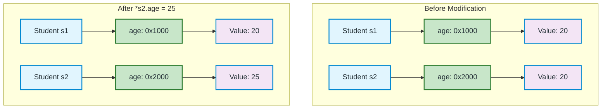
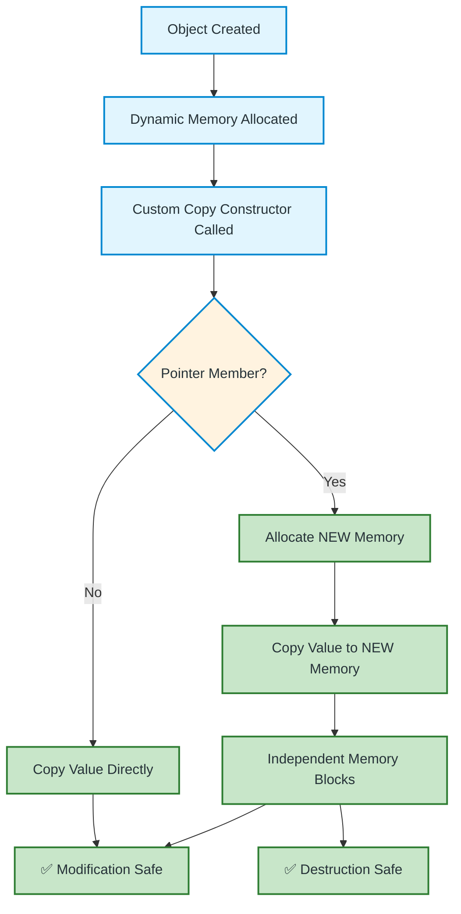
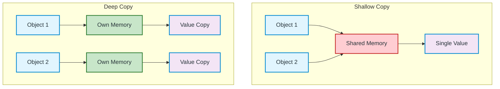

# Deep Copy in C++ — Complete Guide

A comprehensive guide to understanding deep copy, its implementation, and best practices in C++.

---

## What is Deep Copy?

**Deep copy** means creating a completely independent copy of an object, including the dynamically allocated memory it owns. If we modify the copied object's data, the original object remains unchanged.

### Key Characteristics

| Aspect | Behavior |
|--------|----------|
| **Primitive types** | Values are copied directly |
| **Pointers** | New memory allocated, value copied |
| **Memory ownership** | Independent per object |
| **Modification safety** | ✅ Safe - changes don't affect original |
| **Destructor safety** | ✅ Safe - each object frees its own memory |

---

## Visual Representation



---

## Code Example

```cpp
#include <iostream>
using namespace std;

class Student {
public:
    int* age;

    Student(int a) {
        age = new int(a);
    }

    // Deep copy constructor
    Student(const Student& other) {
        age = new int(*other.age);  // Allocate NEW memory, copy VALUE
    }

    // Destructor
    ~Student() {
        delete age;
    }
};

int main() {
    Student s1(20);
    Student s2 = s1;  // Deep copy constructor called

    *s2.age = 25;

    cout << "s1 age: " << *s1.age << endl;  // 20 (unchanged!)
    cout << "s2 age: " << *s2.age << endl;  // 25

    return 0;
}
```

**Output:**
```
s1 age: 20
s2 age: 25
```

---

## Deep Copy Flow Diagram



---

## Complete Implementation: Rule of Three

When a class manages dynamic memory, you must implement all three:

```cpp
#include <iostream>
#include <algorithm>
using namespace std;

class Student {
public:
    int* age;
    string name;

    // 1. Constructor
    Student(string n, int a) : name(n) {
        age = new int(a);
    }

    // 2. Deep Copy Constructor
    Student(const Student& other) : name(other.name) {
        age = new int(*other.age);
        cout << "Deep copy constructor called for " << name << endl;
    }

    // 3. Deep Assignment Operator
    Student& operator=(const Student& other) {
        if (this != &other) {  // Self-assignment check
            name = other.name;
            delete age;                    // Free existing memory
            age = new int(*other.age);     // Allocate new memory
        }
        cout << "Deep assignment operator called for " << name << endl;
        return *this;
    }

    // 4. Destructor
    ~Student() {
        delete age;
        cout << "Destructor called for " << name << endl;
    }

    void display() const {
        cout << name << ": " << *age << endl;
    }
};

int main() {
    Student s1("Alice", 20);
    Student s2 = s1;        // Deep copy constructor
    Student s3("Bob", 25);
    s3 = s1;                // Deep assignment operator

    s1.display();  // Alice: 20
    s2.display();  // Alice: 20
    s3.display();  // Alice: 20

    *s2.age = 30;  // Only affects s2

    s1.display();  // Alice: 20 (SAFE!)
    s2.display();  // Alice: 30
    s3.display();  // Alice: 20 (SAFE!)

    return 0;
}
```

---

## Rule of Three → Rule of Five (C++11)

In modern C++, also implement move operations for performance:

```cpp
class Student {
public:
    int* age;
    string name;

    Student(string n, int a) : name(n), age(new int(a)) {}

    // Copy Constructor (Deep)
    Student(const Student& other) : name(other.name), age(new int(*other.age)) {}

    // Copy Assignment (Deep)
    Student& operator=(const Student& other) {
        if (this != &other) {
            name = other.name;
            delete age;
            age = new int(*other.age);
        }
        return *this;
    }

    // Move Constructor (C++11) - Transfer ownership
    Student(Student&& other) noexcept : name(std::move(other.name)), age(other.age) {
        other.age = nullptr;
    }

    // Move Assignment (C++11) - Transfer ownership
    Student& operator=(Student&& other) noexcept {
        if (this != &other) {
            name = std::move(other.name);
            delete age;
            age = other.age;
            other.age = nullptr;
        }
        return *this;
    }

    ~Student() { delete age; }
};
```

---

## Deep Copy vs Shallow Copy Comparison



---

## Modern C++: Smart Pointers (Recommended)

```cpp
#include <memory>
#include <iostream>
using namespace std;

class Student {
public:
    unique_ptr<int> age;  // Automatic memory management
    string name;

    Student(string n, int a) : name(n), age(make_unique<int>(a)) {}

    // No need for custom copy/assignment/destructor!
    // unique_ptr is non-copyable (prevents shallow copy bugs)
    // Move operations work automatically
};

int main() {
    Student s1("Alice", 20);
    // Student s2 = s1;  // Compile error! Prevents accidental shallow copy
    
    Student s2 = std::move(s1);  // Move instead
    cout << "s2 age: " << *s2.age << endl;  // 20
    
    return 0;
}
```

---

## When to Use Deep Copy

| Scenario | Use Deep Copy? |
|----------|----------------|
| Class has raw pointers | ✅ Yes |
| Class manages resources (files, sockets) | ✅ Yes |
| Class has `std::string`, `std::vector` | ❌ No (they handle it) |
| Simple POD types only | ❌ No (default is fine) |
| Need independent objects | ✅ Yes |
| Performance critical, movable only | Use move semantics |

---

## Best Practices

1. **Prefer smart pointers** (`unique_ptr`, `shared_ptr`) over raw pointers
2. **Follow Rule of Five** if managing resources manually
3. **Check self-assignment** in operator=
4. **Use `std::copy`** for arrays
5. **Consider move semantics** for performance
6. **Delete copy operations** if copying doesn't make sense:
   ```cpp
   Student(const Student&) = delete;
   Student& operator=(const Student&) = delete;
   ```

---

## Quick Reference

```cpp
// Deep Copy Constructor Template
ClassName(const ClassName& other) {
    // 1. Copy primitive members
    member1 = other.member1;
    
    // 2. Deep copy pointer members
    if (other.ptr) {
        ptr = new Type(*other.ptr);
    } else {
        ptr = nullptr;
    }
    
    // 3. Deep copy containers (handled automatically)
    vector = other.vector;
}

// Deep Assignment Operator Template
ClassName& operator=(const ClassName& other) {
    if (this != &other) {  // Self-assignment check
        // 1. Free existing resources
        delete ptr;
        
        // 2. Copy primitive members
        member1 = other.member1;
        
        // 3. Deep copy pointer members
        if (other.ptr) {
            ptr = new Type(*other.ptr);
        } else {
            ptr = nullptr;
        }
        
        // 4. Copy containers
        vector = other.vector;
    }
    return *this;
}
```

---

## Summary

- **Deep copy** = allocates new memory, copies values
- **Essential** for classes with raw pointers
- **Implement**: Copy constructor + Assignment operator + Destructor (Rule of Three)
- **Modern C++**: Use `unique_ptr`/`shared_ptr` to avoid manual management
- **Move semantics** (C++11) for performance optimization