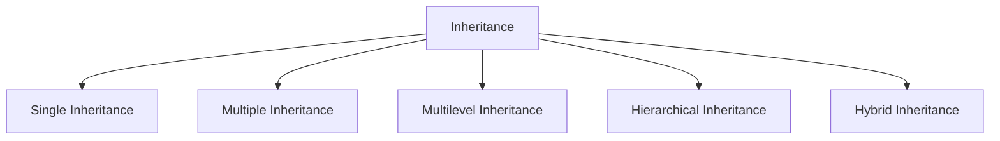

# Inheritance in C++ — Complete Guide

Inheritance is one of the four fundamental pillars of Object-Oriented Programming (OOP), along with **Encapsulation**, **Polymorphism**, and **Abstraction**.

---

## What is Inheritance?

**Definition:** Inheritance is an OOP feature that allows a class (derived class) to acquire the data members and member functions of another class (base class).

In simple words, inheritance allows us to **reuse existing code** instead of writing the same code again.

### Key Terminology

| Term | Description |
|------|-------------|
| **Base Class** (Parent) | The class whose properties are inherited |
| **Derived Class** (Child) | The class that inherits properties from base class |
| **Reusability** | Avoid code duplication by inheriting common functionality |

---

## Types of Inheritance in C++



### 1. Single Inheritance
One derived class inherits from one base class.

```cpp
class Animal {
public:
    void eat() { cout << "Eating..." << endl; }
};

class Dog : public Animal {
public:
    void bark() { cout << "Barking..." << endl; }
};
```

### 2. Multiple Inheritance
One derived class inherits from multiple base classes.

```cpp
class Engine {
public:
    void start() { cout << "Engine started" << endl; }
};

class Wheels {
public:
    void rotate() { cout << "Wheels rotating" << endl; }
};

class Car : public Engine, public Wheels {
public:
    void drive() { cout << "Car driving" << endl; }
};
```

### 3. Multilevel Inheritance
A class is derived from a class which is also derived from another class.

```cpp
class Grandparent {
public:
    void gpMethod() { cout << "Grandparent" << endl; }
};

class Parent : public Grandparent {
public:
    void pMethod() { cout << "Parent" << endl; }
};

class Child : public Parent {
public:
    void cMethod() { cout << "Child" << endl; }
};
```

### 4. Hierarchical Inheritance
Multiple derived classes inherit from a single base class.

```cpp
class Shape {
public:
    void draw() { cout << "Drawing shape" << endl; }
};

class Circle : public Shape { /* ... */ };
class Rectangle : public Shape { /* ... */ };
class Triangle : public Shape { /* ... */ };
```

### 5. Hybrid Inheritance
Combination of two or more types of inheritance.

```cpp
// Combines multiple + multilevel + hierarchical
class A { /* ... */ };
class B : public A { /* ... */ };
class C : public A { /* ... */ };
class D : public B, public C { /* ... */ };  // Diamond problem possible
```

---

## Access Specifiers in Inheritance

| Base Access | Public Derivation | Protected Derivation | Private Derivation |
|-------------|-------------------|----------------------|---------------------|
| **public** | public | protected | private |
| **protected** | protected | protected | private |
| **private** | Not accessible | Not accessible | Not accessible |

> **Best Practice:** Use `public` inheritance for **is-a** relationships. Use `protected`/`private` inheritance rarely (for implementation inheritance).

---

## Constructor/Destructor Order

```cpp
class Base {
public:
    Base() { cout << "Base constructor" << endl; }
    ~Base() { cout << "Base destructor" << endl; }
};

class Derived : public Base {
public:
    Derived() { cout << "Derived constructor" << endl; }
    ~Derived() { cout << "Derived destructor" << endl; }
};

// Output:
// Base constructor
// Derived constructor
// Derived destructor
// Base destructor
```

---

## Key Benefits

| Benefit | Description |
|---------|-------------|
| **Code Reusability** | Avoid rewriting common functionality |
| **Extensibility** | Add new features without modifying base class |
| **Maintainability** | Changes in base class propagate to derived classes |
| **Polymorphism** | Enable runtime polymorphism via virtual functions |

---

## Common Interview Questions

1. **What is the diamond problem?** → Ambiguity in hybrid inheritance when a class inherits from two classes that share a common base. Solved using **virtual inheritance**.

2. **Difference between public/protected/private inheritance?** → Controls accessibility of base class members in derived class.

3. **Constructor/destructor order?** → Base constructor → Derived constructor; Derived destructor → Base destructor.

4. **Can we inherit constructors?** → Yes, using `using Base::Base;` (C++11).

---

## Quick Reference

| Inheritance Type | Use Case |
|------------------|----------|
| **Single** | Simple is-a relationships |
| **Multiple** | Combining independent functionalities |
| **Multilevel** | Layered abstractions |
| **Hierarchical** | Multiple specializations of one concept |
| **Hybrid** | Complex real-world hierarchies |

> **Pro Tip:** Prefer composition over inheritance when possible. Inheritance creates tight coupling; composition provides more flexibility.