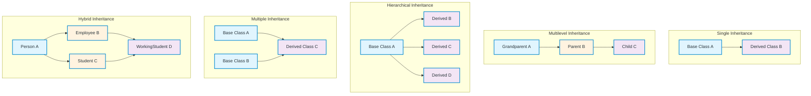
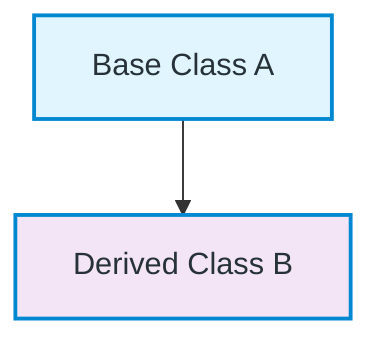
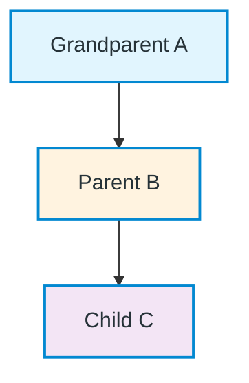
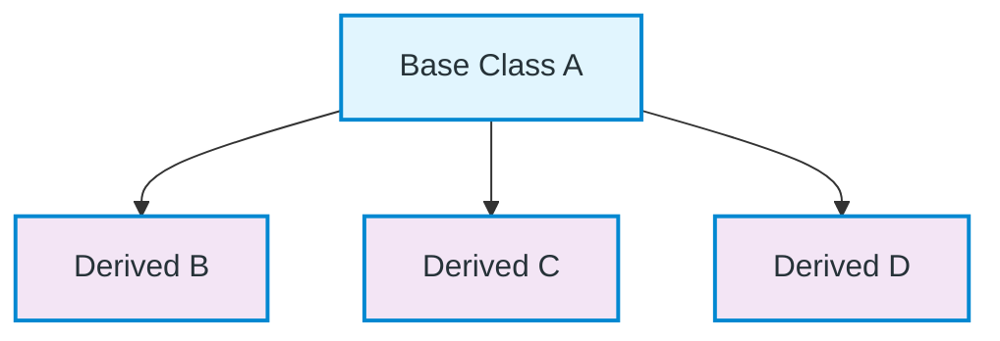
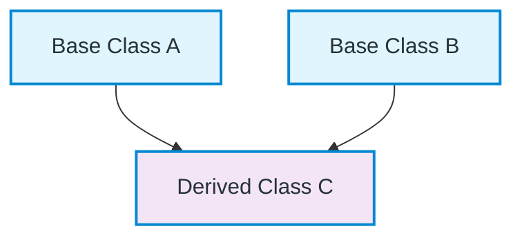
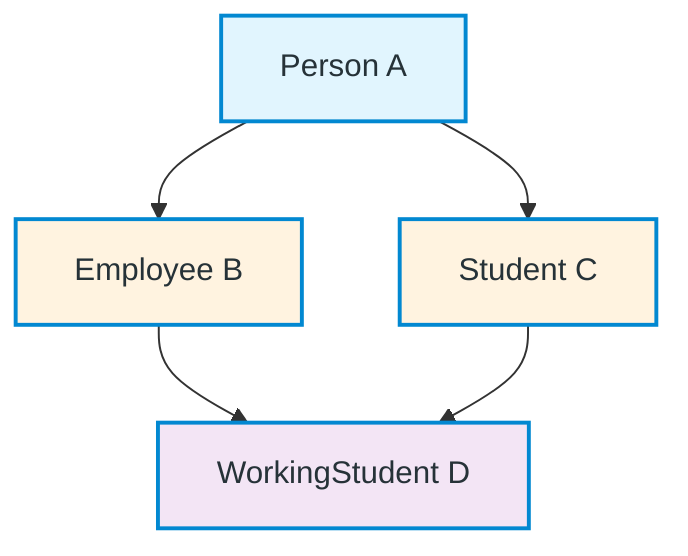
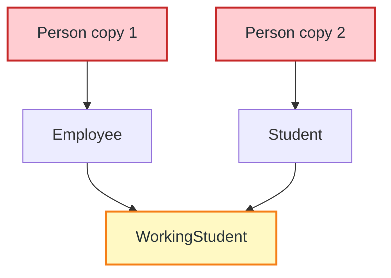
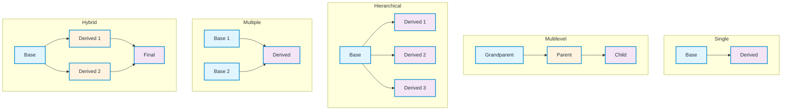

# Inheritance Types in C++ — Quick Reference Guide

A comprehensive overview of all five inheritance types with structure diagrams, real-world examples, and C++ code implementations.

---

## Quick Comparison Table

| Type | Structure | Real-World Example | Key Characteristic |
|------|-----------|-------------------|-------------------|
| **Single** | `A → B` | `Vehicle → Car` | One base, one derived |
| **Multilevel** | `A → B → C` | `Person → Employee → Manager` | Chain of inheritance |
| **Hierarchical** | `A → B` and `A → C` | `Employee → Developer, Manager` | One base, multiple derived |
| **Multiple** | `A + B → C` | `Printer + Scanner → Machine` | Multiple bases, one derived |
| **Hybrid** | Combination | `Person → Employee, Student → WorkingStudent` | Mix of two or more types |

---

## Inheritance Types Overview Diagram



---

## 1. Single Inheritance

### Structure



### ASCII Structure
```
Base Class (A)
    │
    ▼
Derived Class (B)
```

### Real-World Example
**Vehicle → Car** — A car is a type of vehicle.

### C++ Implementation
```cpp
#include <iostream>
using namespace std;

class Vehicle {
public:
    string brand = "Toyota";
    void honk() { cout << "Beep beep!" << endl; }
};

class Car : public Vehicle {
public:
    string model = "Corolla";
    void drive() { cout << "Driving " << brand << " " << model << endl; }
};

int main() {
    Car myCar;
    myCar.honk();    // Inherited from Vehicle
    myCar.drive();   // Own method
    return 0;
}
```

---

## 2. Multilevel Inheritance

### Structure



### ASCII Structure
```
Grandparent (A)
    │
    ▼
Parent (B)
    │
    ▼
Child (C)
```

### Real-World Example
**Person → Employee → Manager** — A manager is an employee, who is a person.

### C++ Implementation
```cpp
#include <iostream>
using namespace std;

class Person {
public:
    string name;
    Person(string n) : name(n) {}
    void introduce() { cout << "Hi, I'm " << name << endl; }
};

class Employee : public Person {
public:
    int employeeId;
    Employee(string n, int id) : Person(n), employeeId(id) {}
    void work() { cout << name << " is working (ID: " << employeeId << ")" << endl; }
};

class Manager : public Employee {
public:
    string department;
    Manager(string n, int id, string dept) : Employee(n, id), department(dept) {}
    void manage() { cout << name << " manages " << department << " department" << endl; }
};

int main() {
    Manager mgr("Alice", 101, "Engineering");
    mgr.introduce();  // From Person
    mgr.work();       // From Employee
    mgr.manage();     // From Manager
    return 0;
}
```

---

## 3. Hierarchical Inheritance

### Structure



### ASCII Structure
```
        Base Class (A)
       /      |      \
      ▼       ▼       ▼
   Derived  Derived  Derived
    (B)      (C)      (D)
```

### Real-World Example
**Employee → Developer, Manager, Designer** — Different roles inheriting from Employee.

### C++ Implementation
```cpp
#include <iostream>
using namespace std;

class Employee {
public:
    string name;
    double baseSalary;
    Employee(string n, double sal) : name(n), baseSalary(sal) {}
    void showDetails() { cout << name << " - Base Salary: $" << baseSalary << endl; }
};

class Developer : public Employee {
public:
    string language;
    Developer(string n, double sal, string lang) : Employee(n, sal), language(lang) {}
    void code() { cout << name << " codes in " << language << endl; }
};

class Manager : public Employee {
public:
    int teamSize;
    Manager(string n, double sal, int size) : Employee(n, sal), teamSize(size) {}
    void lead() { cout << name << " leads a team of " << teamSize << endl; }
};

class Designer : public Employee {
public:
    string tool;
    Designer(string n, double sal, string t) : Employee(n, sal), tool(t) {}
    void design() { cout << name << " designs using " << tool << endl; }
};

int main() {
    Developer dev("Bob", 80000, "C++");
    Manager mgr("Carol", 90000, 5);
    Designer des("Dave", 75000, "Figma");
    
    dev.showDetails(); dev.code();
    mgr.showDetails(); mgr.lead();
    des.showDetails(); des.design();
    return 0;
}
```

---

## 4. Multiple Inheritance

### Structure



### ASCII Structure
```
Base Class A      Base Class B
      │              │
      ▼              ▼
   Derived Class C (inherits from both A and B)
```

### Real-World Example
**Printer + Scanner → AllInOneMachine** — Combines printing and scanning capabilities.

### C++ Implementation
```cpp
#include <iostream>
using namespace std;

class Printer {
public:
    void print(string doc) { cout << "Printing: " << doc << endl; }
};

class Scanner {
public:
    void scan(string doc) { cout << "Scanning: " << doc << endl; }
};

class AllInOneMachine : public Printer, public Scanner {
public:
    void printAndScan(string doc) {
        print(doc);
        scan(doc);
    }
};

int main() {
    AllInOneMachine machine;
    machine.print("Document.pdf");
    machine.scan("Photo.jpg");
    machine.printAndScan("Report.docx");
    return 0;
}
```

---

## 5. Hybrid Inheritance

### Structure



### ASCII Structure
```
        Person (A)
       /         \
      ▼           ▼
  Employee (B)  Student (C)
       \         /
        ▼       ▼
    WorkingStudent (D)
```
*Combines: Hierarchical (A→B, A→C) + Multiple (B+C→D)*

### Real-World Example
**Person → Employee, Student → WorkingStudent** — A working student is both an employee and a student.

### C++ Implementation (with Diamond Problem Solution)
```cpp
#include <iostream>
using namespace std;

// Virtual inheritance solves the diamond problem
class Person {
public:
    string name;
    Person(string n) : name(n) {}
    void introduce() { cout << "I'm " << name << endl; }
};

class Employee : virtual public Person {
public:
    int employeeId;
    Employee(string n, int id) : Person(n), employeeId(id) {}
    void work() { cout << name << " works (ID: " << employeeId << ")" << endl; }
};

class Student : virtual public Person {
public:
    int studentId;
    Student(string n, int id) : Person(n), studentId(id) {}
    void study() { cout << name << " studies (ID: " << studentId << ")" << endl; }
};

class WorkingStudent : public Employee, public Student {
public:
    WorkingStudent(string n, int empId, int stuId) 
        : Person(n), Employee(n, empId), Student(n, stuId) {}
    
    void showRoles() {
        cout << name << " is both Employee(" << employeeId 
             << ") and Student(" << studentId << ")" << endl;
    }
};

int main() {
    WorkingStudent ws("Joy", 1001, 2001);
    ws.introduce();   // Unambiguous - only one Person subobject
    ws.work();
    ws.study();
    ws.showRoles();
    return 0;
}
```

---

## Diamond Problem & Virtual Inheritance

### The Problem
Without `virtual`, hybrid inheritance creates **two copies** of the base class:



### ASCII Structure
```
Person (copy 1)    Person (copy 2)
      │                 │
      ▼                 ▼
  Employee           Student
      \                 /
       ▼               ▼
    WorkingStudent  ← Ambiguous! Which Person::name?
```

### The Solution: Virtual Inheritance
```cpp
class Employee : virtual public Person { ... };
class Student : virtual public Person { ... };
```

This ensures **only one `Person` subobject** exists in `WorkingStudent`.

### Virtual Inheritance Structure

```mermaid
graph TD
    P[Person (single)] --> E[Employee]
    P --> S[Student]
    E --> WS[WorkingStudent]
    S --> WS
    
    classDef baseClass fill:#E1F5FE,color:#263238,stroke:#0288D1,stroke-width:2px
    classDef intermediateClass fill:#FFF3E0,color:#263238,stroke:#0288D1,stroke-width:2px
    classDef derivedClass fill:#F3E5F5,color:#263238,stroke:#0288D1,stroke-width:2px
    classDef solutionClass fill:#C8E6C9,color:#263238,stroke:#2E7D32,stroke-width:3px
    
    class P solutionClass
    class E,S intermediateClass
    class WS derivedClass
```

---

## Summary: When to Use Which?

| Scenario | Recommended Type |
|----------|-----------------|
| Simple "is-a" relationship | **Single** |
| Layered specialization | **Multilevel** |
| Multiple specializations of one concept | **Hierarchical** |
| Combining independent capabilities | **Multiple** |
| Complex real-world hierarchies | **Hybrid** (with virtual inheritance) |

---

## Best Practices

1. **Prefer `public` inheritance** for "is-a" relationships
2. **Use `virtual` inheritance** in hybrid scenarios to avoid diamond problem
3. **Consider composition over inheritance** when possible (looser coupling)
4. **Keep inheritance hierarchies shallow** (max 2-3 levels)
5. **Use `override` keyword** for virtual functions (C++11+)
6. **Make base class destructors `virtual`** for polymorphic deletion

---

## Complete Inheritance Types Summary Diagram



---

## Quick Syntax Reference

```cpp
// Single
class Derived : public Base { };

// Multilevel
class Child : public Parent { };  // Parent : public Grandparent

// Hierarchical
class Derived1 : public Base { };
class Derived2 : public Base { };

// Multiple
class Derived : public Base1, public Base2 { };

// Hybrid (with virtual)
class Base { };
class Derived1 : virtual public Base { };
class Derived2 : virtual public Base { };
class Final : public Derived1, public Derived2 { };
```