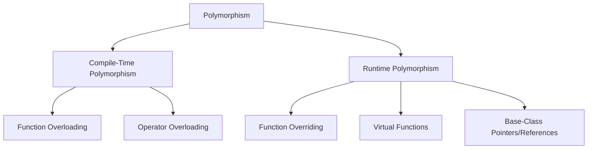

# Polymorphism in C++ — Complete Guide

Polymorphism is one of the four pillars of OOP in C++, along with **Encapsulation**, **Inheritance**, and **Abstraction**.

---

## What is Polymorphism?

| Term | Meaning |
|------|---------|
| **Poly** | Many |
| **Morphism** | Forms |

**Definition:** Polymorphism means "one name, many forms." It allows the same function or interface to behave differently depending on the arguments passed or the object that invokes it.

### Real-World Example

A person can act as:
- A **student** in college
- A **developer** at work
- A **customer** in a shop

The same person behaves differently depending on the situation.

---

## Types of Polymorphism in C++



### 1. Compile-Time Polymorphism (Static Binding)

The compiler determines which function or operator to use at **compile time**.

| Type | Description |
|------|-------------|
| **Function Overloading** | Multiple functions with the same name but different parameters |
| **Operator Overloading** | Redefining operators for user-defined types |

```cpp
// Function Overloading
class Calculator {
public:
    int add(int a, int b) { return a + b; }
    double add(double a, double b) { return a + b; }
    int add(int a, int b, int c) { return a + b + c; }
};

// Operator Overloading
class Complex {
public:
    Complex operator+(const Complex& other) const {
        return Complex(real + other.real, imag + other.imag);
    }
private:
    double real, imag;
};
```

### 2. Runtime Polymorphism (Dynamic Binding)

The program determines which overridden virtual function to call at **runtime**.

| Type | Description |
|------|-------------|
| **Function Overriding** | Derived class provides specific implementation of base class virtual function |
| **Virtual Functions** | Base class functions marked **virtual** to enable dynamic dispatch |
| **Base-Class Pointers/References** | Used to call overridden functions through base class interface |

```cpp
// Runtime Polymorphism Example
class Shape {
public:
    virtual double area() const = 0;  // Pure virtual function
    virtual ~Shape() = default;
};

class Circle : public Shape {
public:
    double area() const override { return 3.14159 * radius * radius; }
private:
    double radius;
};

class Rectangle : public Shape {
public:
    double area() const override { return width * height; }
private:
    double width, height;
};

// Usage
Shape* shapes[] = { new Circle(5), new Rectangle(4, 6) };
for (auto* shape : shapes) {
    std::cout << shape->area() << std::endl;  // Dynamic dispatch
}
```

---

## Quick Comparison

| Aspect | Compile-Time | Runtime |
|--------|--------------|---------|
| **Binding** | Static (early) | Dynamic (late) |
| **Performance** | Faster | Slight overhead |
| **Flexibility** | Limited | High |
| **Mechanism** | Function/Operator overloading | Virtual functions + overriding |
| **Decision Time** | Compile time | Runtime |

---

## Key Takeaways

- **Compile-time polymorphism** → Use for performance-critical code with known types
- **Runtime polymorphism** → Use for extensible designs with unknown derived types
- **Virtual destructor** → Always required in polymorphic base classes
- **override keyword** → Use to catch signature mismatches at compile time