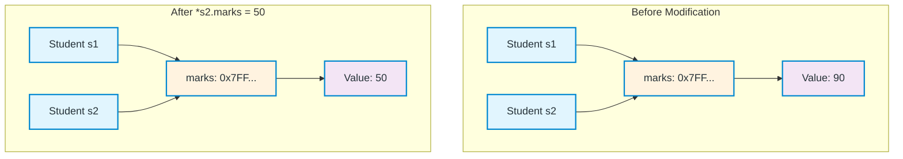
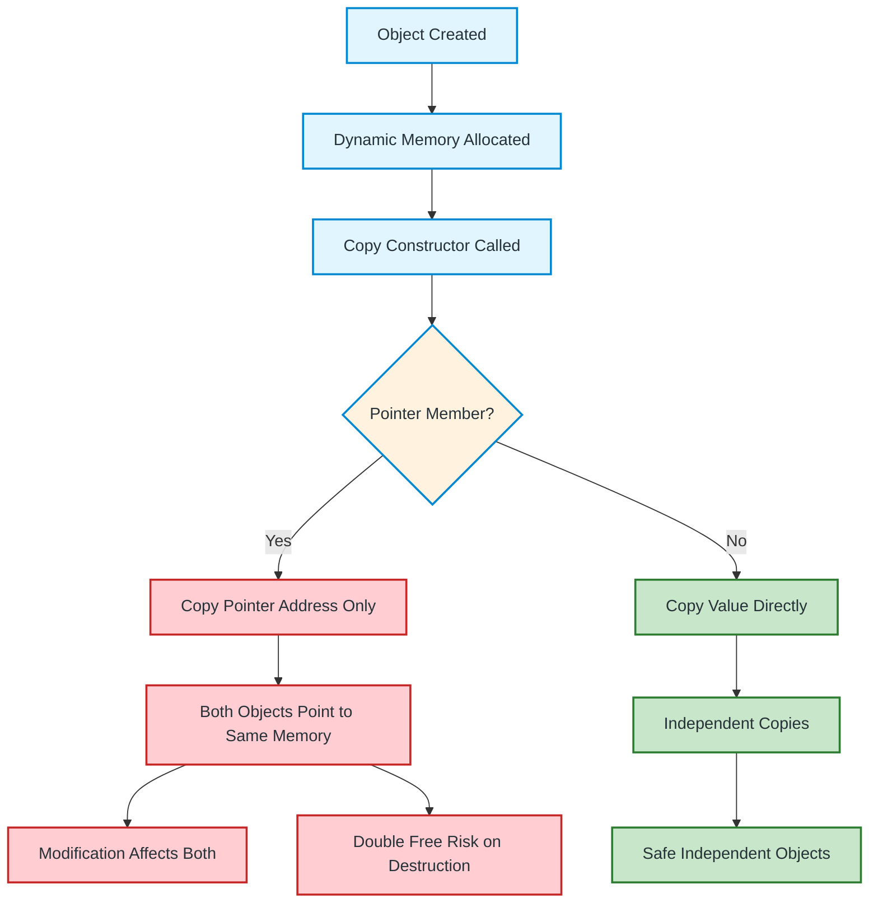
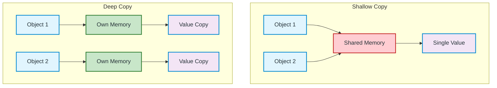

# Shallow Copy in C++ — Complete Guide

A comprehensive guide to understanding shallow copy, its implications, and how to handle it properly in C++.

---

## What is Shallow Copy?

**Shallow copy** means copying the values of an object's data members into another object. If a data member is a **pointer**, only the **pointer address** is copied, not the dynamically allocated memory itself.

### Key Characteristics

| Aspect | Behavior |
|--------|----------|
| **Primitive types** | Values are copied directly |
| **Pointers** | Only address is copied (both point to same memory) |
| **Default behavior** | Compiler-generated copy constructor/assignment do shallow copy |
| **Memory ownership** | Shared between original and copied object |

---

## Visual Representation



---

## Code Example

```cpp
#include <iostream>
using namespace std;

class Student {
public:
    int* marks;

    Student(int m) {
        marks = new int(m);
    }
    
    // Default copy constructor (shallow copy)
    // Student(const Student& other) : marks(other.marks) {}
};

int main() {
    Student s1(90);

    Student s2 = s1;  // Shallow copy - both point to same memory!

    cout << *s1.marks << endl;  // 90
    cout << *s2.marks << endl;  // 90

    *s2.marks = 50;  // Modifies shared memory!

    cout << *s1.marks << endl;  // 50 (s1 affected!)
    cout << *s2.marks << endl;  // 50

    return 0;
}
```

**Output:**
```
90
90
50
50
```

---

## Problems with Shallow Copy

### 1. **Double Free Error**
Both objects try to delete the same memory in their destructors.

```cpp
~Student() {
    delete marks;  // First object deletes OK
}                  // Second object crashes - double free!
```

### 2. **Unexpected Side Effects**
Modifying one object affects the other.

### 3. **Memory Leaks**
If not handled properly, memory may not be freed correctly.

---

## Shallow Copy Flow Diagram



---

## When Does Shallow Copy Happen?

| Scenario | Copy Type |
|----------|-----------|
| Default copy constructor | Shallow |
| Default assignment operator | Shallow |
| `obj2 = obj1` (no custom operator=) | Shallow |
| `Class obj2 = obj1;` (no custom copy ctor) | Shallow |
| Passing/returning by value (no custom copy ctor) | Shallow |

---

## Solutions: Deep Copy

### 1. Custom Copy Constructor
```cpp
class Student {
public:
    int* marks;

    Student(int m) {
        marks = new int(m);
    }

    // Deep copy constructor
    Student(const Student& other) {
        marks = new int(*other.marks);  // Allocate new memory!
    }

    ~Student() {
        delete marks;
    }
};
```

### 2. Custom Assignment Operator
```cpp
Student& operator=(const Student& other) {
    if (this != &other) {  // Self-assignment check
        delete marks;       // Free existing memory
        marks = new int(*other.marks);  // Allocate new memory
    }
    return *this;
}
```

### 3. Rule of Three (C++98) / Rule of Five (C++11)
If you define **any** of these, define **all**:
- Destructor
- Copy Constructor
- Copy Assignment Operator
- Move Constructor (C++11)
- Move Assignment Operator (C++11)

---

## Deep Copy vs Shallow Copy Comparison



---

## Complete Deep Copy Example

```cpp
#include <iostream>
using namespace std;

class Student {
public:
    int* marks;
    string name;

    Student(string n, int m) : name(n) {
        marks = new int(m);
    }

    // Deep Copy Constructor
    Student(const Student& other) : name(other.name) {
        marks = new int(*other.marks);
        cout << "Deep copy constructor called" << endl;
    }

    // Deep Assignment Operator
    Student& operator=(const Student& other) {
        if (this != &other) {
            name = other.name;
            delete marks;
            marks = new int(*other.marks);
            cout << "Deep assignment operator called" << endl;
        }
        return *this;
    }

    // Destructor
    ~Student() {
        delete marks;
        cout << "Destructor called for " << name << endl;
    }

    void display() const {
        cout << name << ": " << *marks << endl;
    }
};

int main() {
    Student s1("Alice", 90);
    Student s2 = s1;        // Deep copy
    Student s3("Bob", 80);
    s3 = s1;                // Deep assignment

    s1.display();  // Alice: 90
    s2.display();  // Alice: 90
    s3.display();  // Alice: 90

    *s2.marks = 50;  // Only affects s2

    s1.display();  // Alice: 90 (unchanged!)
    s2.display();  // Alice: 50
    s3.display();  // Alice: 90 (unchanged!)

    return 0;
}
```

**Output:**
```
Deep copy constructor called
Deep assignment operator called
Alice: 90
Alice: 90
Alice: 90
Alice: 90
Alice: 50
Alice: 90
Destructor called for Alice
Destructor called for Alice
Destructor called for Alice
```

---

## Modern C++: Use Smart Pointers

```cpp
#include <memory>
#include <iostream>
using namespace std;

class Student {
public:
    unique_ptr<int> marks;  // Automatic memory management
    string name;

    Student(string n, int m) : name(n), marks(make_unique<int>(m)) {}

    // No need for custom copy/assignment/destructor!
    // unique_ptr is non-copyable (prevents shallow copy bugs)
    // Use shared_ptr if sharing is intended
};

int main() {
    Student s1("Alice", 90);
    // Student s2 = s1;  // Compile error! Prevents accidental shallow copy
    
    // For sharing, use shared_ptr:
    // shared_ptr<int> marks = make_shared<int>(90);
    
    return 0;
}
```

---

## Quick Reference

| Concept | Shallow Copy | Deep Copy |
|---------|--------------|-----------|
| **Pointer handling** | Copies address | Allocates new memory |
| **Memory ownership** | Shared | Independent |
| **Modification safety** | Unsafe (affects both) | Safe (independent) |
| **Destructor safety** | Double free risk | Safe |
| **Performance** | Faster | Slower (allocation overhead) |
| **Default behavior** | Yes | No (must implement) |

---

## Best Practices

1. **Prefer `std::unique_ptr` or `std::shared_ptr`** over raw pointers
2. **Follow Rule of Three/Five** if managing resources manually
3. **Delete copy operations** if copying doesn't make sense:
   ```cpp
   Student(const Student&) = delete;
   Student& operator=(const Student&) = delete;
   ```
4. **Use `= default`** for trivial copyable types
5. **Consider move semantics** for performance (C++11+)

---

## Summary

- **Shallow copy** = copies pointer addresses, shares memory
- **Dangerous** with raw pointers → double free, unexpected modifications
- **Solution**: Implement deep copy (custom copy ctor + assignment + destructor)
- **Modern C++**: Use smart pointers to avoid manual memory management entirely