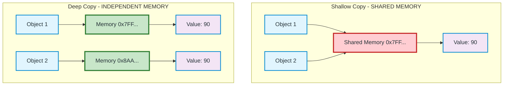
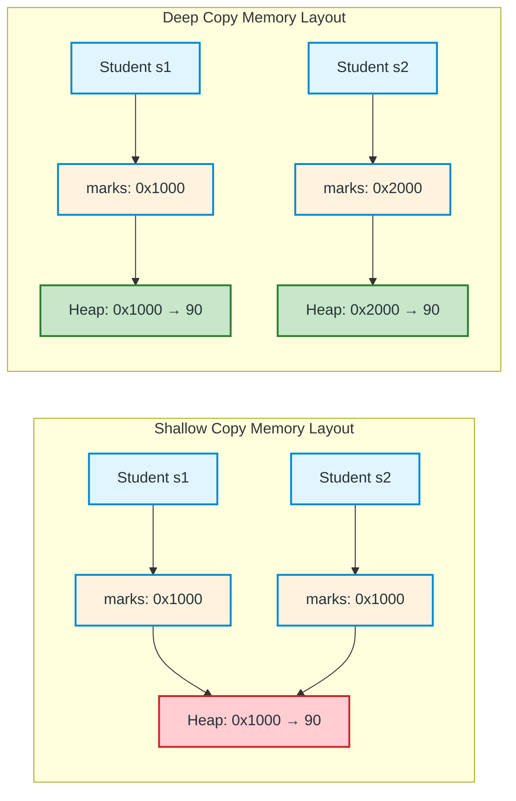
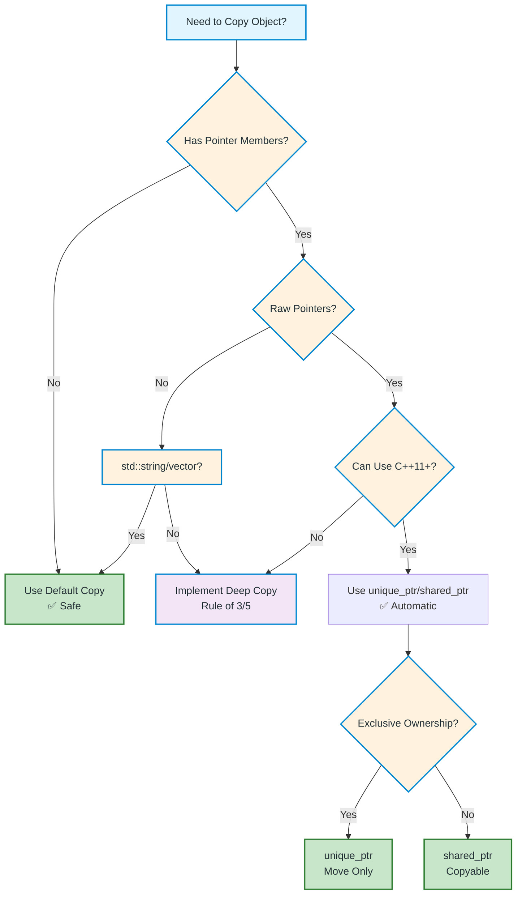

# Shallow Copy vs Deep Copy in C++ — Complete Comparison Guide

A comprehensive side-by-side comparison of shallow copy and deep copy with flowcharts, code examples, and best practices.

---

## Quick Comparison Overview

| Aspect | Shallow Copy | Deep Copy |
|--------|--------------|-----------|
| **Definition** | Copies member values; pointers share same memory | Creates independent copy including dynamic memory |
| **Pointer Handling** | Copies address only | Allocates new memory, copies value |
| **Memory Ownership** | Shared between objects | Independent per object |
| **Modification Safety** | ❌ Unsafe - affects both objects | ✅ Safe - independent |
| **Destructor Safety** | ❌ Double-free risk | ✅ Safe |
| **Performance** | Faster (no allocation) | Slower (allocation overhead) |
| **Default Behavior** | ✅ Yes (compiler-generated) | ❌ No (must implement) |
| **Use Case** | Simple types, no pointers | Classes with pointers/resources |

---

## Visual Comparison



---

## Memory Layout Comparison



---

## Code Comparison

### Shallow Copy (Problematic)
```cpp
class Student {
public:
    int* marks;
    
    Student(int m) { marks = new int(m); }
    // NO custom copy constructor - uses default (shallow)
    ~Student() { delete marks; }
};

int main() {
    Student s1(90);
    Student s2 = s1;  // Shallow copy!
    
    *s2.marks = 50;   // Modifies SHARED memory
    
    cout << *s1.marks; // 50 - s1 affected!
    cout << *s2.marks; // 50
    
    // CRASH: Double free when both destructors run
    return 0;
}
```

### Deep Copy (Safe)
```cpp
class Student {
public:
    int* marks;
    
    Student(int m) { marks = new int(m); }
    
    // Deep copy constructor
    Student(const Student& other) {
        marks = new int(*other.marks);  // NEW allocation!
    }
    
    // Deep assignment operator
    Student& operator=(const Student& other) {
        if (this != &other) {
            delete marks;               // Free old memory
            marks = new int(*other.marks); // Allocate new
        }
        return *this;
    }
    
    ~Student() { delete marks; }
};

int main() {
    Student s1(90);
    Student s2 = s1;  // Deep copy!
    
    *s2.marks = 50;   // Modifies ONLY s2's memory
    
    cout << *s1.marks; // 90 - s1 UNCHANGED!
    cout << *s2.marks; // 50
    
    // SAFE: Each destructor frees its own memory
    return 0;
}
```

---

## Process Flow Comparison

```mermaid
flowchart TD
    subgraph "Shallow Copy Process"
        SC_A[Create Object] --> SC_B[Allocate Memory]
        SC_B --> SC_C[Copy Constructor Called]
        SC_C --> SC_D{Pointer Member?}
        SC_D -->|Yes| SC_E[Copy Address Only]
        SC_D -->|No| SC_F[Copy Value]
        SC_E --> SC_G[Both Point to Same Memory]
        SC_G --> SC_H[⚠️ Modification Affects Both]
        SC_G --> SC_I[⚠️ Double Free on Destruction]
        SC_F --> SC_J[✅ Independent Values]
    end
    
    subgraph "Deep Copy Process"
        DC_A[Create Object] --> DC_B[Allocate Memory]
        DC_B --> DC_C[Custom Copy Constructor]
        DC_C --> DC_D{Pointer Member?}
        DC_D -->|Yes| DC_E[Allocate NEW Memory]
        DC_D -->|No| DC_F[Copy Value]
        DC_E --> DC_G[Copy Value to NEW Memory]
        DC_G --> DC_H[✅ Independent Memory]
        DC_H --> DC_I[✅ Safe Modification]
        DC_H --> DC_J[✅ Safe Destruction]
        DC_F --> DC_I
    end
    
    classDef process fill:#E1F5FE,color:#263238,stroke:#0288D1,stroke-width:2px
    classDef decision fill:#FFF3E0,color:#263238,stroke:#0288D1,stroke-width:2px
    classDef risk fill:#FFCDD2,color:#263238,stroke:#C62828,stroke-width:2px
    classDef safe fill:#C8E6C9,color:#263238,stroke:#2E7D32,stroke-width:2px
    
    class SC_A,SC_B,SC_C,DC_A,DC_B,DC_C process
    class SC_D,DC_D decision
    class SC_E,SC_G,SC_H,SC_I risk
    class SC_F,SC_J,DC_E,DC_F,DC_G,DC_H,DC_I,DC_J safe
```



---

## When to Use Which?

### Use Shallow Copy When:
- ✅ Class has **no pointers** or dynamic memory
- ✅ All members are **primitive types** (int, float, bool, etc.)
- ✅ Members are **standard containers** (std::string, std::vector) - they handle deep copy internally
- ✅ You explicitly **want shared ownership** (use `shared_ptr` instead)

### Use Deep Copy When:
- ✅ Class owns **raw pointers** to dynamic memory
- ✅ Class manages **resources** (file handles, sockets, etc.)
- ✅ You need **independent objects** that can be modified separately
- ✅ Following **Rule of Three/Five**

---

## Rule of Three / Five Implementation

```cpp
class ResourceManager {
private:
    int* data;
    size_t size;
    
public:
    // 1. Constructor
    ResourceManager(size_t s) : size(s), data(new int[s]) {}
    
    // 2. Destructor
    ~ResourceManager() { delete[] data; }
    
    // 3. Copy Constructor (Deep)
    ResourceManager(const ResourceManager& other) 
        : size(other.size), data(new int[other.size]) {
        std::copy(other.data, other.data + size, data);
    }
    
    // 4. Copy Assignment (Deep)
    ResourceManager& operator=(const ResourceManager& other) {
        if (this != &other) {
            delete[] data;
            size = other.size;
            data = new int[size];
            std::copy(other.data, other.data + size, data);
        }
        return *this;
    }
    
    // 5. Move Constructor (C++11)
    ResourceManager(ResourceManager&& other) noexcept 
        : data(other.data), size(other.size) {
        other.data = nullptr;
        other.size = 0;
    }
    
    // 6. Move Assignment (C++11)
    ResourceManager& operator=(ResourceManager&& other) noexcept {
        if (this != &other) {
            delete[] data;
            data = other.data;
            size = other.size;
            other.data = nullptr;
            other.size = 0;
        }
        return *this;
    }
};
```

---

## Modern C++: Smart Pointers (Recommended)


### unique_ptr (Exclusive Ownership)
```cpp
#include <memory>

class Student {
    std::unique_ptr<int> marks;  // Cannot be copied!
public:
    Student(int m) : marks(std::make_unique<int>(m)) {}
    
    // Copy constructor DELETED automatically
    // Student(const Student&) = delete;
    // Student& operator=(const Student&) = delete;
    
    // But movable!
    Student(Student&&) = default;
    Student& operator=(Student&&) = default;
};
```

### shared_ptr (Shared Ownership)
```cpp
#include <memory>

class Student {
    std::shared_ptr<int> marks;  // Can be copied!
public:
    Student(int m) : marks(std::make_shared<int>(m)) {}
    
    // Copy constructor works - shares ownership
    // Reference count increments automatically
};
```

---

## Complete Working Example

```cpp
#include <iostream>
#include <memory>
#include <string>
using namespace std;

// ============ SHALLOW COPY (Problematic) ============
class ShallowStudent {
public:
    int* marks;
    string name;
    
    ShallowStudent(string n, int m) : name(n) {
        marks = new int(m);
    }
    
    ~ShallowStudent() { delete marks; }
    
    void display() { cout << name << ": " << *marks << endl; }
};

// ============ DEEP COPY (Safe) ============
class DeepStudent {
public:
    int* marks;
    string name;
    
    DeepStudent(string n, int m) : name(n) {
        marks = new int(m);
    }
    
    // Deep copy constructor
    DeepStudent(const DeepStudent& other) : name(other.name) {
        marks = new int(*other.marks);
    }
    
    // Deep assignment operator
    DeepStudent& operator=(const DeepStudent& other) {
        if (this != &other) {
            name = other.name;
            delete marks;
            marks = new int(*other.marks);
        }
        return *this;
    }
    
    ~DeepStudent() { delete marks; }
    
    void display() { cout << name << ": " << *marks << endl; }
};

// ============ MODERN C++ (Best) ============
class ModernStudent {
public:
    unique_ptr<int> marks;
    string name;
    
    ModernStudent(string n, int m) : name(n), marks(make_unique<int>(m)) {}
    
    // No manual memory management needed!
    // unique_ptr handles everything
    
    void display() { cout << name << ": " << *marks << endl; }
};

int main() {
    cout << "=== SHALLOW COPY ===" << endl;
    ShallowStudent ss1("Alice", 90);
    ShallowStudent ss2 = ss1;  // Shallow!
    *ss2.marks = 50;
    ss1.display();  // Alice: 50 (AFFECTED!)
    ss2.display();  // Alice: 50
    
    cout << "\n=== DEEP COPY ===" << endl;
    DeepStudent ds1("Bob", 90);
    DeepStudent ds2 = ds1;  // Deep!
    *ds2.marks = 50;
    ds1.display();  // Bob: 90 (SAFE!)
    ds2.display();  // Bob: 50
    
    cout << "\n=== MODERN C++ ===" << endl;
    ModernStudent ms1("Carol", 90);
    // ModernStudent ms2 = ms1;  // COMPILE ERROR - prevented!
    ModernStudent ms2 = std::move(ms1);  // Move instead
    ms2.display();  // Carol: 90
    
    return 0;
}
```

---

## Decision Flowchart



---

## Summary Checklist

### Shallow Copy Checklist
- [ ] Class has no raw pointers
- [ ] No dynamic memory allocation
- [ ] No resource handles (files, sockets)
- [ ] All members are trivially copyable
- [ ] Default copy/assignment is sufficient

### Deep Copy Checklist
- [ ] Custom copy constructor implemented
- [ ] Custom assignment operator implemented
- [ ] Destructor properly frees memory
- [ ] Self-assignment check in operator=
- [ ] Exception safety considered
- [ ] Move operations implemented (C++11+)

### Modern C++ Checklist
- [ ] Use `unique_ptr` for exclusive ownership
- [ ] Use `shared_ptr` for shared ownership
- [ ] Avoid raw `new`/`delete`
- [ ] Use `make_unique`/`make_shared`
- [ ] Prefer move semantics over copy

---

## Key Takeaways

| Scenario | Recommendation |
|----------|----------------|
| **Simple class, no pointers** | Default shallow copy ✅ |
| **Raw pointers to memory** | Deep copy OR smart pointers |
| **C++11 or later** | **Always prefer smart pointers** |
| **Shared ownership needed** | `shared_ptr` |
| **Exclusive ownership** | `unique_ptr` |
| **Legacy code (pre-C++11)** | Rule of Three (deep copy) |
| **Performance critical** | Move semantics + `unique_ptr` |

> **Golden Rule**: In modern C++, **avoid raw pointers** entirely. Use `std::unique_ptr` by default, `std::shared_ptr` when sharing is needed. This eliminates shallow copy bugs completely.